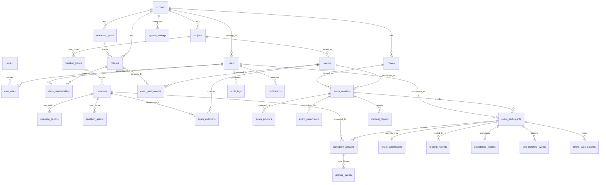

# 02 — Entity Relationship Diagram (ERD) & Skema Database (31 Tabel)

## 1. Entity Relationship Diagram (Mermaid)

## 2. Daftar Lengkap 31 Tabel Utama PostgreSQL

Seluruh tabel menggunakan `UUID` atau `BIGSERIAL` sebagai Primary Key, `TIMESTAMPTZ` (UTC) untuk seluruh kolom waktu (`created_at`, `updated_at`, `deleted_at`), dan Foreign Key dengan aturan integritas referensial yang eksplisit.

1. **`schools`**: Identitas sekolah, kode sekolah, zona waktu default (`Asia/Makassar`), konfigurasi retensi & kebijakan umum.
2. **`academic_years`**: Tahun ajaran dan semester (`name`, `semester`, `is_active`, `start_date`, `end_date`).
3. **`users`**: Akun pengguna (`school_id`, `username`, `email`, `full_name`, `nisn_nip`, `password_hash` Argon2id, `is_active`, `failed_login_attempts`, `locked_until`, `last_login_at`).
4. **`roles`**: Master 5 role (`ADMIN`, `TEACHER`, `PROCTOR`, `SUPERVISOR`, `STUDENT`).
5. **`user_roles`**: Relasi many-to-many antara `users` dan `roles` (`UNIQUE (user_id, role_id)`).
6. **`classes`**: Data kelas/tingkat (`school_id`, `academic_year_id`, `name`, `grade_level`, `homeroom_teacher_id`).
7. **`class_memberships`**: Keanggotaan siswa atau guru pengampu pada kelas/rombel (`class_id`, `user_id`, `membership_type`, `UNIQUE (class_id, user_id)`).
8. **`subjects`**: Mata pelajaran (`school_id`, `code`, `name`, `teacher_ids` / relasi guru pengampu).
9. **`rooms`**: Ruang ujian fisik/virtual (`school_id`, `code`, `name`, `capacity`).
10. **`question_banks`**: Bank soal per mata pelajaran dan pembuat (`school_id`, `subject_id`, `owner_teacher_id`, `title`, `description`, `is_shared`).
11. **`questions`**: Butir soal dengan versioning (`question_bank_id`, `question_type` [`SINGLE_CHOICE`, `MULTIPLE_CHOICE_COMPLEX`, `TRUE_FALSE`, `SHORT_ANSWER`, `ESSAY`], `status` [`DRAFT`, `REVIEW`, `PUBLISHED`], `version`, `difficulty`, `category`, `tags`, `stem_html`, `table_data`, `formula_latex`, `weight`, `answer_key` JSONB, `explanation_html`, `created_by`).
12. **`question_options`**: Pilihan jawaban untuk PG, PG Kompleks, dan Benar-Salah (`question_id`, `option_key`, `content_html`, `is_correct`, `sort_order`).
13. **`question_assets`**: Aset gambar/media soal yang disimpan di object storage (`question_id`, `asset_type`, `storage_key`, `mime_type`, `file_size_bytes`, `alt_text`).
14. **`exams`**: Paket ujian & kebijakan keamanan (`school_id`, `subject_id`, `academic_year_id`, `title`, `code`, `status` [`DRAFT`, `SCHEDULED`, `READY`, `IN_PROGRESS`, `PAUSED`, `SUBMITTED`, `EXPIRED`, `CANCELLED`], `duration_minutes`, `randomize_questions`, `randomize_options`, `browser_policy` [`SECURE_BROWSER_REQUIRED`, `SECURE_BROWSER_OPTIONAL`, `STANDARD_BROWSER`], `seb_config_key_hash`, `camera_Enabled`, `camera_retention_days`, `offline_enabled`, `offline_grace_period_seconds`, `max_offline_unsynced_answers`, `conflict_policy`, `publish_results`, `created_by`).
15. **`exam_questions`**: Daftar soal dalam paket ujian beserta kunci versi soal (`exam_id`, `question_id`, `question_version`, `order_no`, `weight_override`, `UNIQUE (exam_id, question_id)`).
16. **`exam_assignments`**: Penugasan paket ujian ke kelas/rombel (`exam_id`, `class_id`, `UNIQUE (exam_id, class_id)`).
17. **`exam_sessions`**: Jadwal dan sesi ruang ujian (`exam_id`, `room_id`, `title`, `session_token`, `status`, `scheduled_start_at`, `scheduled_end_at`, `actual_started_at`).
18. **`exam_proctors`**: Penugasan proktor pada sesi ujian (`exam_session_id`, `proctor_user_id`, `UNIQUE (exam_session_id, proctor_user_id)`).
19. **`exam_supervisors`**: Penugasan pengawas pada sesi/ruang ujian (`exam_session_id`, `room_id`, `supervisor_user_id`, `UNIQUE (exam_session_id, supervisor_user_id)`).
20. **`exam_participants`**: Sesi pengerjaan per siswa (`exam_session_id`, `exam_id`, `student_user_id`, `status` [`READY`, `IN_PROGRESS`, `PAUSED`, `SUBMITTED`, `EXPIRED`, `CANCELLED`], `question_order` JSONB, `option_orders` JSONB, `started_at`, `server_deadline_at`, `extra_time_seconds`, `submitted_at`, `active_session_fingerprint`, `seb_verified`, `seb_override_by_proctor_id`, `camera_consent_given`, `camera_Alternative_approved`, `connection_status`, `offline_since_at`, `unsynced_count`, `last_heartbeat_at`, `final_score`, `UNIQUE (exam_session_id, student_user_id)`).
21. **`participant_answers`**: Jawaban terkini per soal per peserta (`exam_participant_id`, `question_id`, `answer_payload` JSONB, `is_marked_for_review`, `answer_version`, `last_idempotency_key`, `client_updated_at`, `server_saved_at`, `sync_source` [`ONLINE`, `OFFLINE_SYNC`], `UNIQUE (exam_participant_id, question_id)`).
22. **`answer_events`**: Jejak audit perubahan setiap jawaban (`participant_answer_id`, `exam_participant_id`, `question_id`, `idempotency_key` `UNIQUE`, `answer_version`, `previous_payload` JSONB, `new_payload` JSONB, `is_marked_for_review`, `source`, `created_at`).
23. **`exam_submissions`**: Bukti pengumpulan akhir yang idempoten (`exam_participant_id` `UNIQUE`, `idempotency_key` `UNIQUE`, `submitted_by_user_id`, `submission_reason` [`MANUAL_SUBMIT`, `TIMER_EXPIRED`, `PROCTOR_FORCE_SUBMIT`], `answers_snapshot` JSONB, `auto_score`, `manual_score`, `total_score`, `grading_status`, `submitted_at`).
24. **`grading_records`**: Rincian nilai per butir soal per peserta yang mengacu pada versi soal saat dikerjakan (`exam_participant_id`, `question_id`, `question_version`, `is_auto_graded`, `is_correct`, `score_awarded`, `max_score`, `graded_by_user_id`, `feedback`, `graded_at`, `UNIQUE (exam_participant_id, question_id)`).
25. **`attendance_records`**: Catatan kehadiran peserta oleh pengawas/proktor (`exam_session_id`, `exam_participant_id` `UNIQUE`, `status` [`PRESENT`, `ABSENT`, `LATE`, `EXCUSED`], `notes`, `recorded_by_user_id`, `recorded_at`).
26. **`incident_reports`**: Berita acara kejadian/gangguan teknis (`exam_session_id`, `exam_participant_id`, `reported_by_user_id`, `escalated_to_admin`, `severity`, `category`, `title`, `description`, `resolution_notes`, `status`, `created_at`).
27. **`anti_cheating_events`**: Pencatatan 16 jenis event keamanan (`exam_session_id`, `exam_participant_id`, `event_type`, `classification` [`INFORMATION`, `ATTENTION`, `REVIEW_REQUIRED`, `SECURITY_INCIDENT`], `duration_ms`, `metadata` JSONB, `reviewed_by_user_id`, `review_notes`, `occurred_at`, `recorded_at`).
28. **`offline_sync_batches`**: Catatan sinkronisasi antrean offline (`exam_participant_id`, `batch_idempotency_key` `UNIQUE`, `items_count`, `accepted_count`, `conflict_count`, `rejected_count`, `offline_duration_seconds`, `status`, `details` JSONB, `synced_at`).
29. **`audit_logs`**: Log audit imutabel untuk seluruh tindakan sensitif (`school_id`, `actor_user_id`, `actor_role`, `action`, `target_type`, `target_id`, `metadata` JSONB, `ip_address`, `user_agent`, `created_at`).
30. **`notifications`**: Pengumuman & notifikasi terarah (`school_id`, `recipient_user_id`, `recipient_role`, `title`, `body`, `type`, `is_read`, `created_at`).
31. **`system_settings`**: Konfigurasi operasional sekolah & sistem (`school_id`, `setting_key`, `setting_value` JSONB, `updated_by_user_id`, `UNIQUE (school_id, setting_key)`).

## 3. Indeks Terukur Berdasarkan Pola Query 500+ Sesi
- `idx_exam_participants_session_status` pada `exam_participants (exam_session_id, status)` untuk dashboard proktor/pengawas.
- `idx_exam_participants_student` pada `exam_participants (student_user_id, status)` untuk daftar ujian siswa.
- `idx_participant_answers_participant` pada `participant_answers (exam_participant_id, question_id)` untuk pembacaan/penyimpanan jawaban cepat (< 10 ms).
- `idx_anti_cheating_session_class` pada `anti_cheating_events (exam_session_id, classification, recorded_at DESC)` untuk monitoring keamanan inkremental.
- `idx_audit_logs_actor_created` pada `audit_logs (school_id, created_at DESC, action)` untuk penelusuran audit.
