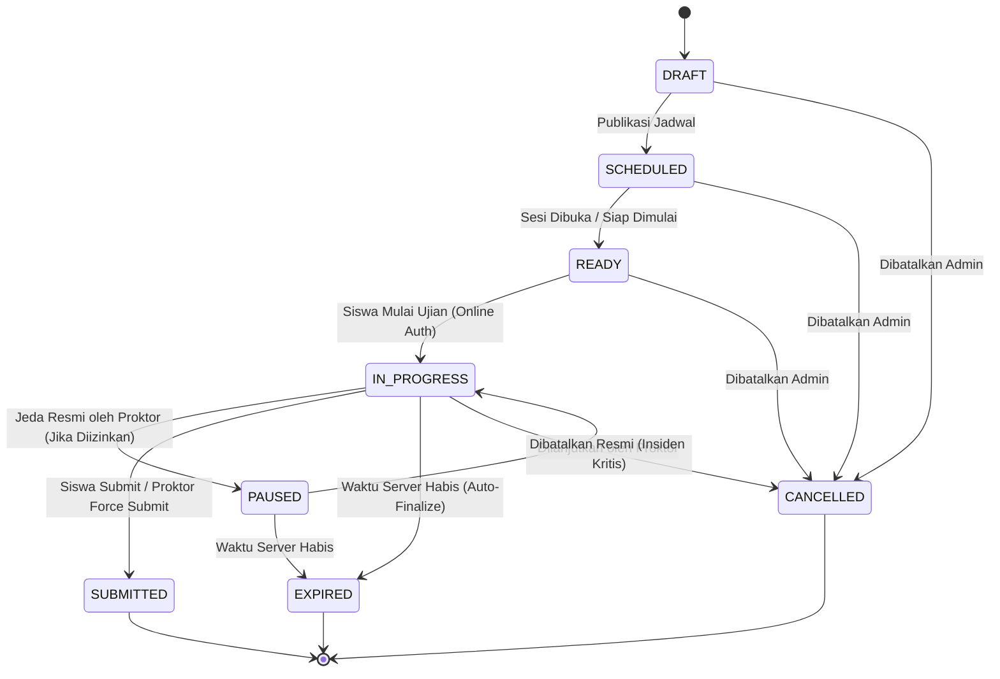

# 05 — Kontrak API & State Machine Ujian

## 1. State Machine Ujian & Sesi Peserta

### Aturan Transisi Valid di Backend
- `DRAFT -> SCHEDULED | CANCELLED`
- `SCHEDULED -> READY | CANCELLED`
- `READY -> IN_PROGRESS | CANCELLED`
- `IN_PROGRESS -> PAUSED | SUBMITTED | EXPIRED | CANCELLED`
- `PAUSED -> IN_PROGRESS | SUBMITTED | EXPIRED | CANCELLED`
- Status terminal (`SUBMITTED`, `EXPIRED`, `CANCELLED`) **tidak dapat** kembali ke `IN_PROGRESS` kecuali melalui prosedur pemulihan insiden luar biasa yang diotorisasi Admin/Proktor sebelum batas jadwal ujian berakhir dan tercatat di `audit_logs`.

## 2. Ringkasan Endpoint REST API (`/api/v1`)

### 2.1 Autentikasi & Profil (`/api/v1/auth`)
- `POST /api/v1/auth/login` — Login dengan username/email & password (Argon2id), mengembalikan token sesi + HttpOnly cookie + CSRF token.
- `POST /api/v1/auth/logout` — Mencabut sesi aktif di database/Redis.
- `POST /api/v1/auth/refresh` — Rotasi token sesi.
- `GET /api/v1/auth/me` — Mengambil profil pengguna aktif, daftar role, dan zona waktu sekolah.

### 2.2 Manajemen Akademik & Pengguna (`/api/v1/academic`, `/api/v1/users`)
- `GET|POST|PATCH /api/v1/users` — Manajemen pengguna & penetapan 5 role (`ADMIN`).
- `GET|POST|PATCH /api/v1/academic/years` — Manajemen tahun ajaran (`ADMIN`).
- `GET|POST|PATCH /api/v1/academic/classes` — Manajemen kelas & keanggotaan rombel (`ADMIN`, `TEACHER` baca).
- `GET|POST|PATCH /api/v1/academic/subjects` — Manajemen mata pelajaran (`ADMIN`, `TEACHER` baca).
- `GET|POST|PATCH /api/v1/academic/rooms` — Manajemen ruang ujian (`ADMIN`).
- `GET|PATCH /api/v1/settings` — Pengaturan keamanan, kamera opsional, & offline grace period (`ADMIN`).

### 2.3 Bank Soal & Paket Ujian (`/api/v1/question-banks`, `/api/v1/exams`)
- `GET|POST|PATCH /api/v1/question-banks` — CRUD bank soal (`ADMIN`, `TEACHER`).
- `GET|POST|PATCH /api/v1/question-banks/:bankId/questions` — CRUD soal (5 tipe, versioning, aset, kunci jawaban) (`ADMIN`, `TEACHER`).
- `POST /api/v1/question-banks/:bankId/import` & `GET /api/v1/question-banks/:bankId/export` — Impor/ekspor soal JSON/CSV.
- `GET|POST|PATCH /api/v1/exams` — CRUD paket ujian, aturan acak, kebijakan SEB/kamera/offline (`ADMIN`, `TEACHER`).
- `POST /api/v1/exams/:examId/status` — Transisi state machine paket ujian (`ADMIN`, `TEACHER`).
- `GET|POST|PATCH /api/v1/exam-sessions` — Jadwal sesi ruang ujian, penetapan proktor & pengawas (`ADMIN`).

### 2.4 Mesin Ujian Siswa (`/api/v1/student/exams`)
- `GET /api/v1/student/exams` — Daftar jadwal ujian yang ditugaskan ke kelas siswa.
- `POST /api/v1/student/exams/:sessionId/device-check` — Verifikasi kompatibilitas perangkat, header SEB, & consent kamera opsional.
- `POST /api/v1/student/exams/:sessionId/start` — Memulai/melanjutkan sesi ujian, mengembalikan `serverNow`, `serverDeadlineAt`, dan daftar soal **tanpa kunci jawaban**.
- `GET /api/v1/student/participants/:participantId/paper` — Mengambil naskah soal sesuai urutan teracak peserta + status jawaban tersimpan server.
- `PUT /api/v1/student/participants/:participantId/answers` — Autosave satu jawaban (`questionId`, `answerPayload`, `isMarkedForReview`, `idempotencyKey`, `expectedVersion`).
- `POST /api/v1/student/participants/:participantId/offline-sync` — Sinkronisasi berurutan antrean jawaban dari IndexedDB (`batchIdempotencyKey`, `items[]`).
- `POST /api/v1/student/participants/:participantId/submit` — Pengumpulan akhir ujian secara idempoten (`idempotencyKey`).
- `POST /api/v1/student/participants/:participantId/heartbeat` — Sinkronisasi waktu server & status koneksi/buffer lokal.

### 2.5 Anti-Kecurangan, Monitoring Proktor/Pengawas & Penilaian
- `POST /api/v1/security/events` — Pencatatan event keamanan dari sesi terverifikasi.
- `GET /api/v1/monitoring/sessions/:sessionId/summary` — Ringkasan real-time proktor/pengawas (total, belum mulai, aktif, selesai, terputus, offline dalam toleransi, lewat batas offline, jumlah event).
- `GET /api/v1/monitoring/sessions/:sessionId/participants` — Daftar peserta terpaginasi dengan filter kelas/ruang/status.
- `POST /api/v1/monitoring/participants/:participantId/attendance` — Pencatatan kehadiran (`PROCTOR`, `SUPERVISOR`, `ADMIN`).
- `POST /api/v1/monitoring/participants/:participantId/warning` — Pengiriman peringatan proktor (`PROCTOR`, `ADMIN`).
- `POST /api/v1/monitoring/participants/:participantId/recover` — Pemulihan sesi / reset kunci sesi / perpanjangan waktu terotorisasi / pengecualian SEB tercatat (`PROCTOR`, `ADMIN`).
- `GET|POST /api/v1/monitoring/sessions/:sessionId/incidents` — Laporan insiden & eskalasi ke Admin (`PROCTOR`, `SUPERVISOR`, `ADMIN`).
- `POST /api/v1/grading/participants/:participantId/essay` — Penilaian manual soal esai (`TEACHER`, `ADMIN`).
- `GET /api/v1/reports/exams/:examId/analytics` — Rekap hasil, analisis butir soal, dan ekspor CSV/XLSX/PDF (`ADMIN`, `TEACHER`).
- `GET /api/v1/audit-logs` — Penelusuran log audit (`ADMIN`, `PROCTOR` terbatas).
